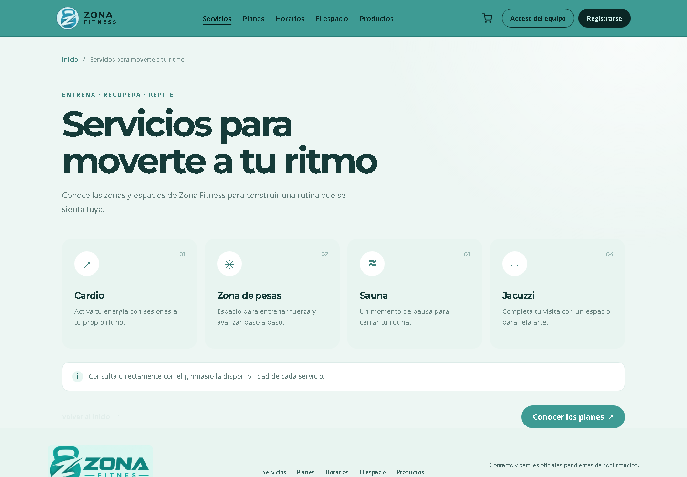
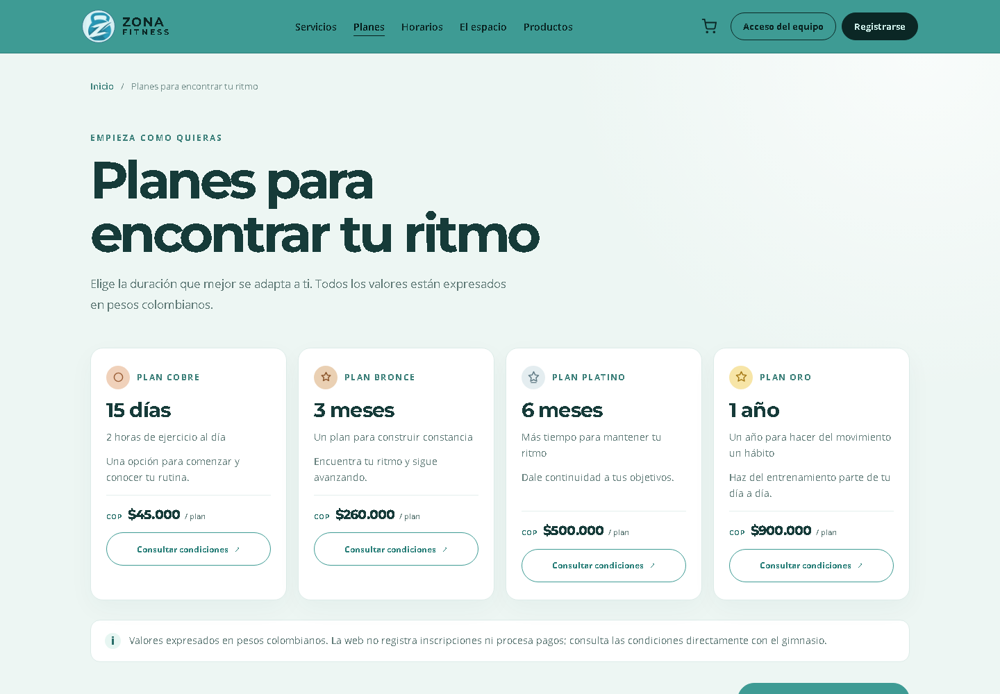
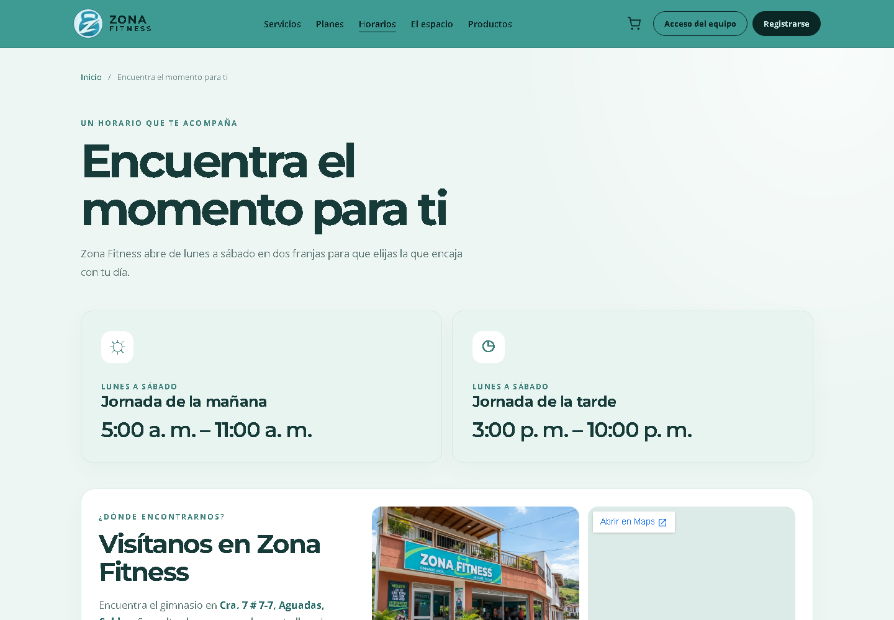
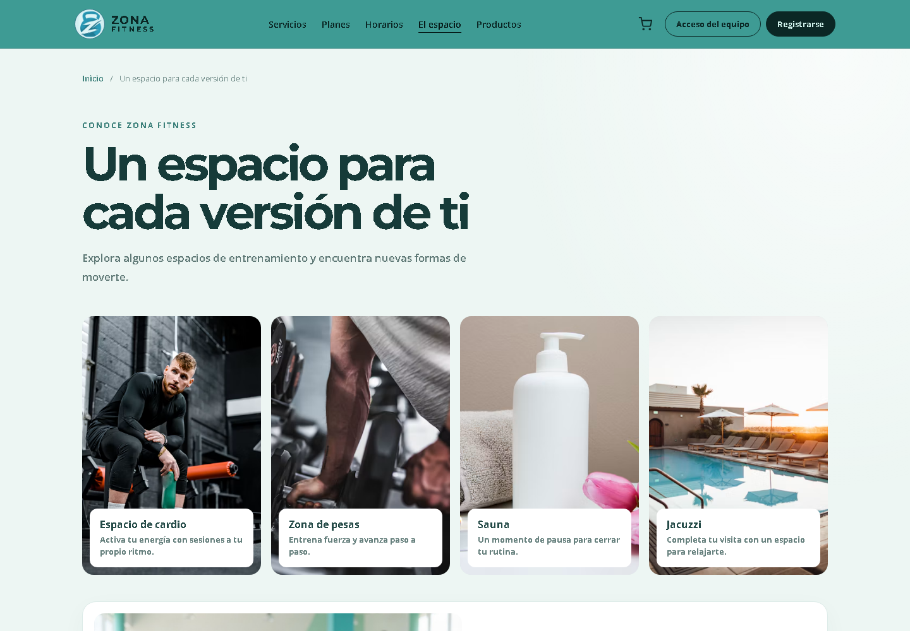
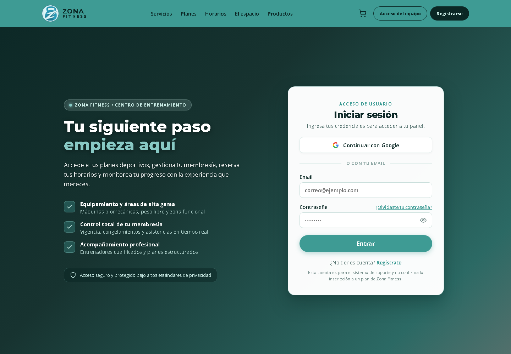

# Manual de entrega al cliente

## Zona Fitness

**Versión:** 1.0  
**Fecha:** 29 de octubre de 2026  
**Sitio publicado:** https://yhojan2025.github.io/zona-fitness/  
**Repositorio:** https://github.com/yhojan2025/zona-fitness

> Este manual presenta el recorrido completo de la plataforma, explica qué puede hacer
> cada visitante o miembro del equipo y reúne la documentación técnica, operativa y de
> mantenimiento entregada con el proyecto.

---

## Índice

1. [Presentación](#1-presentación)
2. [Equipo de desarrollo](#2-equipo-de-desarrollo)
3. [Acceso y requisitos](#3-acceso-y-requisitos)
4. [Recorrido general de la página](#4-recorrido-general-de-la-página)
5. [Mapa de navegación](#5-mapa-de-navegación)
6. [Guía de cada sección pública](#6-guía-de-cada-sección-pública)
7. [Acceso del equipo y soporte interno](#7-acceso-del-equipo-y-soporte-interno)
8. [Experiencia móvil y accesibilidad](#8-experiencia-móvil-y-accesibilidad)
9. [Publicación, seguridad y límites actuales](#9-publicación-seguridad-y-límites-actuales)
10. [Sección dedicada al código](#10-sección-dedicada-al-código)
11. [Mantenimiento y actualización de contenido](#11-mantenimiento-y-actualización-de-contenido)
12. [Documentación relacionada](#12-documentación-relacionada)
13. [Lista de validación para la entrega](#13-lista-de-validación-para-la-entrega)

---

## 1. Presentación

Zona Fitness es una plataforma web responsive para presentar el gimnasio, sus
servicios, planes, horarios, espacios, productos y canales de atención. El sitio
está diseñado para que una persona pueda conocer la propuesta del gimnasio desde
computador, tableta o teléfono sin instalar aplicaciones.

La identidad visual utiliza una combinación de verde profundo, turquesa, fondos
claros, tarjetas redondeadas y tipografías de lectura limpia. El tono de la
experiencia es cercano, activo y orientado a que cada visitante encuentre su ritmo.

### Datos de acceso

| Dato | Valor |
|---|---|
| URL pública | https://yhojan2025.github.io/zona-fitness/ |
| HTTPS | Activado |
| Hosting | GitHub Pages |
| Despliegue | Automático desde `main` mediante GitHub Actions |
| Dominio personalizado | No configurado |
| Código fuente | https://github.com/yhojan2025/zona-fitness |


*Figura 1. Vista de inicio de Zona Fitness.*

---

## 2. Equipo de desarrollo

| Rol | Responsable |
|---|---|
| Gestor de proyectos | **Brahiam Antonio Bedoya** |
| Desarrollador | **Oscar Jhonny Hurtado** |
| Analista | **Yhojan David Pérez** |

El equipo participó en la definición del recorrido, la estructuración de la
aplicación, la implementación de componentes, el control de calidad, la publicación
y la documentación de la solución.

---

## 3. Acceso y requisitos

### Para visitantes

Solo se requiere un navegador actualizado y conexión a internet. La dirección
recomendada es la URL pública indicada en este documento.

### Para administrar el proyecto

El mantenimiento del código requiere:

- Node.js 20 o superior.
- npm.
- Git.
- PostgreSQL 18 para ejecutar el backend local y las pruebas relacionadas.
- Acceso al repositorio GitHub y a la configuración de GitHub Pages.

### Compatibilidad

La interfaz se adapta a escritorio, tableta y móvil. En pantallas pequeñas la
navegación principal se transforma en un menú hamburguesa; el botón de acceso del
equipo no compite con ese menú y se mantiene disponible desde el recorrido interno.


*Figura 2. Vista móvil responsive.*

---

## 4. Recorrido general de la página

### 4.1 Encabezado

El encabezado contiene:

- Logotipo e identidad de Zona Fitness.
- Enlaces a Servicios, Planes, Horarios, El espacio y Productos.
- Carrito informativo.
- Acceso del equipo en escritorio.
- Menú hamburguesa en dispositivos móviles.

La navegación conserva el contexto de la persona y permite volver al inicio desde el
logotipo.

### 4.2 Hero o portada

La portada presenta el mensaje principal de la marca, una llamada a explorar los
planes y una galería visual. El carrusel dispone de controles manuales, indicador de
progreso, textos alternativos y opción para pausar o reanudar la rotación.

### 4.3 Servicios

La página presenta las zonas principales del gimnasio:

- Cardio.
- Zona de pesas.
- Sauna.
- Jacuzzi.

Cada servicio se muestra como una tarjeta independiente con descripción y recurso
visual asociado.

### 4.4 Planes

Se muestran cuatro alternativas informativas:

- Cobre.
- Bronce.
- Platino.
- Oro.

Las tarjetas presentan duración, descripción, categoría y llamada a consultar
condiciones. Los precios se mantienen como “Precio por confirmar” hasta recibir una
aprobación oficial del gimnasio.

### 4.5 Horarios y ubicación

La sección de horarios comunica las franjas de atención y ofrece el bloque de
ubicación, mapa y referencia visual de la fachada. Antes de publicar cambios
comerciales, el gimnasio debe confirmar cualquier modificación de horarios, dirección
o condiciones especiales.

### 4.6 El espacio

La galería presenta el ambiente y las zonas de entrenamiento. Incluye una fachada
referencial con el logo superpuesto para conservar la identidad visual de Zona
Fitness.

### 4.7 Productos

El catálogo es informativo y agrupa:

- Batidos de proteína.
- Suplementación.
- Productos para entrenar.

No es una tienda electrónica completa: no procesa pagos, no confirma inventario y no
debe interpretarse como una orden de compra automática.

### 4.8 Inscripción informativa

La portada explica cómo consultar condiciones, menciona medios informativos como
Nequi y Bancolombia y presenta la regla de edad mínima indicada para el proyecto.
Los datos bancarios, precios y condiciones finales deben ser suministrados y
aprobados por el gimnasio antes de incorporarse al contenido público.

### 4.9 Redes sociales

La página incluye maquetas locales de Instagram, Facebook y WhatsApp Business para
mostrar cómo podría verse la presencia digital de la marca. Estas maquetas son
prototipos visuales: no reemplazan perfiles oficiales ni envían mensajes reales.

---

## 5. Mapa de navegación

```text
/
├── /servicios       Servicios y zonas del gimnasio
├── /planes          Planes informativos
├── /horarios        Horarios, ubicación y fachada
├── /espacio         Galería y espacios
├── /productos       Catálogo informativo
├── /politica-datos  Política de tratamiento de datos
├── /privacidad      Vista de privacidad
├── /carrito         Carrito persistido para usuarios autenticados
├── /checkout        Generación de pedido pendiente
├── /login           Acceso del equipo
├── /register        Registro interno
├── /tickets         Soporte autenticado
├── /users           Administración con rol admin
└── cualquier ruta  Redirección al inicio
```

### Enlaces directos

- [Inicio](https://yhojan2025.github.io/zona-fitness/)
- [Servicios](https://yhojan2025.github.io/zona-fitness/servicios)
- [Planes](https://yhojan2025.github.io/zona-fitness/planes)
- [Horarios](https://yhojan2025.github.io/zona-fitness/horarios)
- [El espacio](https://yhojan2025.github.io/zona-fitness/espacio)
- [Productos](https://yhojan2025.github.io/zona-fitness/productos)
- [Política de datos](https://yhojan2025.github.io/zona-fitness/politica-datos)
- [Acceso del equipo](https://yhojan2025.github.io/zona-fitness/login)

---

## 6. Guía de cada sección pública

### Servicios



La página permite entender las áreas del gimnasio y sirve como punto de entrada para
personas que todavía no conocen la sede.

### Planes



Los planes se presentan como opciones de referencia. La confirmación comercial debe
realizarse directamente con Zona Fitness mientras los precios y condiciones no estén
aprobados en el contenido.

### Horarios



La fachada y el mapa ayudan a ubicar la sede. Las imágenes actuales son recursos
referenciales incorporados al proyecto y deben reemplazarse por fotografías oficiales
si el cliente las entrega.

### El espacio



La galería está organizada para mostrar las zonas de cardio, pesas, sauna y jacuzzi,
con textos alternativos para mejorar la comprensión y accesibilidad.

### Productos


La sección comunica categorías de productos sin inventar precios, stock o datos de
contacto. Cualquier ampliación a comercio electrónico requiere un alcance adicional.

### Política y privacidad

La plataforma incluye una página pública de tratamiento de datos y textos de
privacidad. El registro interno solicita consentimiento conforme al flujo definido
para el proyecto.

---

## 7. Acceso del equipo y soporte interno



El acceso del equipo está separado de la experiencia promocional. Incluye:

- Inicio de sesión con correo y contraseña.
- Registro de cuentas internas.
- Gestión de tickets de soporte.
- Vista de cuenta.
- Gestión de usuarios para roles administrativos.

El acceso del equipo no equivale a una inscripción comercial de un cliente del
gimnasio. Las funcionalidades de Google, recuperación de contraseña y pasarelas de
pago están preparadas visualmente, pero permanecen pendientes de integración real.

### Roles

- **Usuario:** puede consultar su cuenta y sus pedidos, además de gestionar tickets
  según los permisos configurados.
- **Administrador:** puede acceder a la gestión de usuarios y las herramientas de
  soporte disponibles para su rol.

### Carrito y pedidos

El sistema contempla carrito persistido, cálculo de totales en servidor, generación
de pedido pendiente y código único de pedido. La implementación no constituye una
pasarela de pago y no almacena tarjetas de crédito.

---

## 8. Experiencia móvil y accesibilidad

La interfaz fue revisada para evitar solapamientos, desbordamiento horizontal y
elementos que se corten en pantallas estrechas.

Características principales:

- Menú hamburguesa accesible.
- Encabezado flexible.
- Ocultamiento del acceso de equipo en la barra superior móvil para evitar
  competencia visual con el menú.
- Tablas con desplazamiento horizontal cuando el contenido lo necesita.
- Textos alternativos descriptivos en imágenes informativas.
- Estados de foco visibles para teclado.
- Etiquetas ARIA en carrusel, botones y regiones principales.
- Soporte para reducción de movimiento en el carrusel.

---

## 9. Publicación, seguridad y límites actuales

### Publicación

GitHub Pages compila Angular con la base `/zona-fitness/`, genera el fallback
`404.html` para el enrutamiento SPA y publica `dist/frontend/browser`. Cada cambio
fusionado en `main` activa el workflow de despliegue.

### HTTPS

El sitio usa HTTPS mediante la URL estándar de GitHub Pages. No hay dominio
personalizado configurado.

### Seguridad

- Contraseñas del backend con bcrypt.
- Tokens JWT con expiración.
- Guardas de autenticación y roles.
- Validación de propiedad de recursos para evitar accesos cruzados.
- No se guardan datos de tarjetas.
- Los secretos deben mantenerse en variables de entorno y nunca en el repositorio.

### Límites funcionales que el cliente debe conocer

- Los precios, datos bancarios, contactos y enlaces sociales oficiales requieren
  confirmación.
- Las maquetas sociales son locales y no están conectadas a redes externas.
- Los pagos reales no están implementados.
- El backend incluido está preparado para desarrollo/local; requiere configuración de
  producción antes de operar fuera del equipo de desarrollo.
- La web no incluye un panel CMS para editar contenido sin modificar código.

---

## 10. Sección dedicada al código

### Arquitectura

| Capa | Tecnología | Ubicación |
|---|---|---|
| Frontend | Angular 22 | `src/` |
| Estilos | CSS y hojas por componente | `src/styles.css`, `src/app/**/*.css` |
| Recursos | Imágenes y prototipos | `public/` |
| Backend | Node.js + Express | `server/src/` |
| Base de datos | PostgreSQL 18 | `server/src/db/` |
| Pruebas frontend | Vitest integrado con Angular | `src/**/*.spec.ts` |
| Despliegue | GitHub Actions + GitHub Pages | `.github/workflows/` |

### Estructura principal

```text
src/
├── app/
│   ├── core/                 Servicios, modelos, guards e interceptores
│   ├── pages/                Vistas de inicio, cuenta, carrito y secciones
│   ├── shared/               Footer y componentes compartidos
│   ├── app.routes.ts         Rutas y carga diferida
│   ├── app.html              Shell de navegación
│   └── app.css               Header y responsive global
├── styles.css                Estilos globales
└── index.html                Metadatos de la aplicación

server/
├── src/routes/               Endpoints REST
├── src/middleware/           Autenticación y autorización
├── src/config/               Política de datos y configuración
└── src/db/migrations/        Esquema y datos iniciales

public/
├── zona-fitness-logo.png
├── zona-fitness-icon.png
├── zona-fitness-fachada.jpg
├── zona-fitness-atleta-hidratandose.jpg
└── redes/                    Maquetas y recursos sociales
```

### Comandos principales

```powershell
npm ci
npm start
npm run build -- --base-href /zona-fitness/
npm test -- --watch=false
npm run server
```

### Pruebas y calidad

La suite cubre componentes Angular, navegación, autenticación, carrito, roles,
validaciones, API y base de datos. Antes de publicar:

1. Ejecutar las pruebas unitarias y de integración disponibles.
2. Ejecutar el build de producción.
3. Revisar la landing en escritorio y móvil.
4. Confirmar imágenes, rutas y enlaces.
5. Fusionar únicamente cambios validados en `main`.

### Flujo de despliegue

```text
Cambio en código
      ↓
Pruebas y build
      ↓
Pull request / revisión
      ↓
Merge a main
      ↓
GitHub Actions
      ↓
dist/frontend/browser
      ↓
GitHub Pages
```

---

## 11. Mantenimiento y actualización de contenido

El sitio usa contenido estático de Angular; no existe un CMS. Para actualizar textos,
planes, servicios o imágenes:

1. Editar el archivo de contenido correspondiente.
2. Mantener textos alternativos y rutas relativas.
3. No publicar precios, contactos, datos bancarios o redes sin confirmación.
4. Ejecutar pruebas y build.
5. Revisar el resultado en escritorio y móvil.
6. Crear commit y fusionar a `main`.
7. Confirmar el workflow de GitHub Pages.

### Archivos de contenido frecuentes

| Necesidad | Archivo |
|---|---|
| Servicios, planes, carrusel y galería | `src/app/pages/home/home.ts` |
| Textos de portada y bloques informativos | `src/app/pages/home/home.html` |
| Páginas de sección | `src/app/pages/section-page/section-page.ts` |
| Menú y encabezado | `src/app/app.html` |
| Imágenes y logo | `public/` |
| Maquetas sociales | `public/redes/` |
| Datos de privacidad | `server/src/config/privacy_policy.js` |

### Datos pendientes de confirmar

| Dato | Tratamiento recomendado |
|---|---|
| Precios | Mantener “Precio por confirmar” |
| Teléfono o correo | No inventar; solicitar valor oficial |
| Redes oficiales | Agregar solo URL confirmada |
| Datos de pago | No publicar hasta aprobación |
| Fotografías oficiales | Reemplazar imágenes referenciales |
| API de producción | Definir entorno y URL antes del lanzamiento |

---

## 12. Documentación relacionada

La entrega incluye los siguientes documentos fuente:

- [Guía técnica de Zona Fitness](guia-tecnica-zona-fitness.md)
- [Guía breve para actualizar contenido](actualizar-contenido.md)
- [Arquitectura de base de datos](arquitectura-base-de-datos.md)
- [Guía de administración con pgAdmin 4](guia-administracion-pgadmin4.md)
- [Entregables, sitemap y wireframe](entregables-zona-fitness.md)
- [Diagrama del flujo](diagrama-flujo.md)
- [Progreso del proyecto al 26 de octubre](progreso-zona-fitness-2026-10-26.md)
- [Progreso y alcance al 28 de octubre](progreso-zona-fitness-2026-10-28.md)
- [Cotización revisada](cotizacion-revisada-zona-fitness-2026-10-28.md)
- [Propuesta técnica V2](Propuesta-tecnica-Zona-Fitness-V2.pdf)
- [Manual de marca](Manual_Marca_Zona_Fitness.pptx)
- [Mockup y prototipo web en Figma](https://www.figma.com/design/tJSu1aJTykZSVqmVA2XUOj/Zona-fitness---Mockup-y-prototipo-web?node-id=6-2)
- [Wireframe V2 en Figma](https://www.figma.com/design/0cFykiLWJPm8vRnY7l71M1/Zona-fitness---Wireframe-V2?node-id=0-1)
- [Repositorio GitHub](https://github.com/yhojan2025/zona-fitness)
- [Aplicación publicada](https://yhojan2025.github.io/zona-fitness/)

---

## 13. Lista de validación para la entrega

- [x] Aplicación publicada con HTTPS.
- [x] Rutas públicas documentadas.
- [x] Responsive revisado en escritorio y móvil.
- [x] Imágenes de la aplicación incluidas.
- [x] Código, arquitectura y comandos documentados.
- [x] Equipo de desarrollo identificado.
- [x] Documentos técnicos y de diseño enlazados.
- [ ] Confirmar precios y condiciones comerciales.
- [ ] Confirmar teléfono, correo, dirección definitiva y redes oficiales.
- [ ] Reemplazar imágenes referenciales por fotografías aprobadas, si aplica.
- [ ] Definir backend, dominio y operación de producción si se requiere comercio real.

---

**Zona Fitness — Tu espacio para moverte.**
