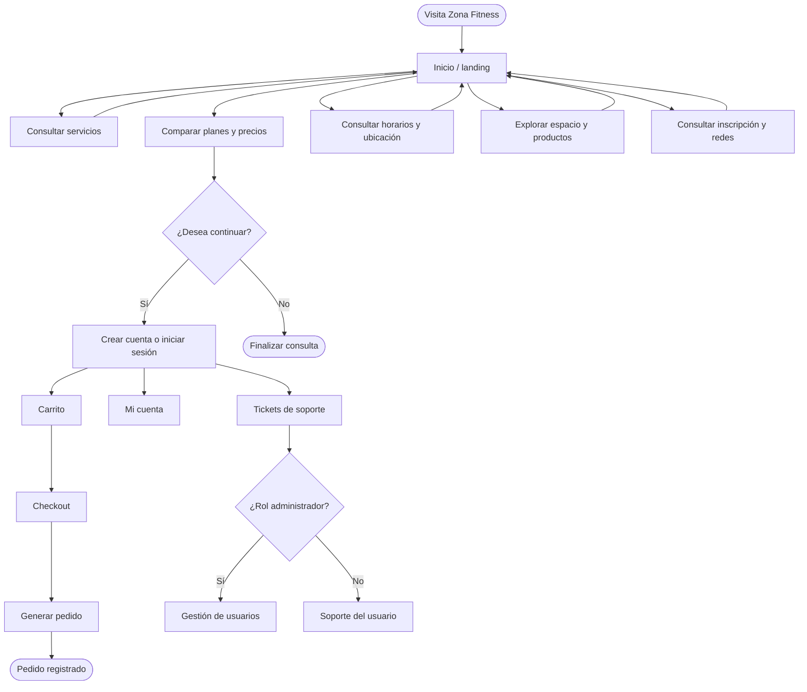

# PROYECTO GUIADO 1

## Zona Fitness

### Del análisis de requisitos a una plataforma web funcional

**Caso de estudio para Análisis y Diseño de Soluciones Web**  
**Universidad de Caldas · Programa Técnico en Programación Web**  
**Versión final:** 29 de octubre de 2026  
**Estado:** Todas las metas del proyecto alcanzadas

---

## Propósito

Este documento presenta el proceso completo de Zona Fitness: análisis del problema,
definición de responsabilidades, arquitectura de información, wireframe, estructura
del DOM, implementación, pruebas, despliegue y entrega. La solución fue construida
para que el gimnasio disponga de una experiencia web responsive, accesible y
publicada, con un módulo interno de soporte para cuentas, pedidos, tickets y
administración.

## Ficha del proyecto

| Campo | Resultado |
|---|---|
| Cliente | Zona Fitness |
| Tipo de solución | Plataforma web responsive para promoción, consulta y soporte |
| Usuarios principales | Visitantes, usuarios autenticados, equipo de soporte y administradores |
| Frontend | Angular 22, TypeScript, HTML semántico y CSS por componente |
| Backend | Node.js, Express y API REST |
| Base de datos | PostgreSQL 18 |
| Publicación | GitHub Pages mediante GitHub Actions |
| URL pública | https://yhojan2025.github.io/zona-fitness/ |
| Repositorio | https://github.com/yhojan2025/zona-fitness |
| Resultado | Implementado, probado, documentado y publicado |

---

## Índice

1. [Introducción](#1-introducción)
2. [Equipo y responsabilidades](#2-equipo-y-responsabilidades)
3. [Actores y objetivos](#3-actores-y-objetivos)
4. [Análisis de requisitos](#4-análisis-de-requisitos)
5. [Mapa del sitio](#5-mapa-del-sitio)
6. [Wireframe y arquitectura de información](#6-wireframe-y-arquitectura-de-información)
7. [Estructura del DOM](#7-estructura-del-dom)
8. [Flujo de navegación](#8-flujo-de-navegación)
9. [Implementación tecnológica](#9-implementación-tecnológica)
10. [Responsive, accesibilidad y seguridad](#10-responsive-accesibilidad-y-seguridad)
11. [QA y criterios de aceptación](#11-qa-y-criterios-de-aceptación)
12. [Despliegue y entrega](#12-despliegue-y-entrega)
13. [Entregables](#13-entregables)
14. [Conclusión](#14-conclusión)

---

## 1. Introducción

Zona Fitness necesitaba una presencia digital que comunicara sus servicios,
planes, horarios, espacios, productos y medios de inscripción con una identidad
visual consistente. Además de la experiencia pública, el proyecto integra un
entorno de soporte para autenticación, pedidos, tickets y gestión administrativa.

El trabajo no se limitó a construir pantallas: incluyó levantamiento de necesidades,
organización del contenido, separación entre actores del sistema y roles del equipo,
diseño responsive, validación automatizada, documentación para el cliente y
publicación en HTTPS.

La versión final alcanza los objetivos definidos: el sitio está disponible, los
recursos cargan correctamente bajo `/zona-fitness/`, las vistas se adaptan a móvil
sin solapamientos, las rutas funcionan y la documentación permite mantener el
proyecto.

---

## 2. Equipo y responsabilidades

Los roles del equipo describen responsabilidades de construcción y entrega. No deben
confundirse con los actores que utilizan el sistema.

| Integrante | Rol principal | Responsabilidades | Evidencia |
|---|---|---|---|
| **Brahiam Antonio Bedoya** | Gestor de proyectos | Planificar el alcance, coordinar tareas, organizar prioridades, hacer seguimiento a riesgos, facilitar acuerdos y verificar la entrega integral. | Cronología del proyecto, decisiones de alcance, control de entregables y coordinación de publicación. |
| **Oscar Jhonny Hurtado** | Desarrollador | Implementar el frontend Angular, componentes, estilos, responsive, integración con API, manejo de rutas y corrección de defectos técnicos. | Código en `src/`, `server/`, pruebas de componentes, build y correcciones responsive. |
| **Yhojan David Pérez** | Analista | Identificar necesidades, documentar requisitos, estructurar la información, definir criterios de aceptación, revisar la experiencia y consolidar la documentación. | Manual del cliente, guía técnica, sitemap, diagramas, matriz de entregables y validación funcional. |

### Responsabilidad compartida

Todo el equipo participó en la revisión del contenido, verificación de la
experiencia móvil, control de calidad, preparación de la entrega y confirmación de
la versión publicada. La coordinación por roles no impidió la colaboración cruzada.

### Actores del sistema frente a roles del equipo

| Actores del sistema | Roles del equipo |
|---|---|
| Visitante que consulta servicios y planes | Gestor, analista y desarrollador |
| Usuario autenticado que gestiona su cuenta y pedidos | Desarrollador y analista |
| Equipo de soporte que atiende tickets | Desarrollador y gestor |
| Administrador que gestiona usuarios | Desarrollador |
| Cliente Zona Fitness que recibe y utiliza la solución | Todo el equipo |

---

## 3. Actores y objetivos

### Actores identificados

- **Visitante:** consulta la propuesta del gimnasio, los planes, horarios,
  instalaciones, productos y medios de inscripción.
- **Usuario autenticado:** administra sus datos, carrito, pedidos, membresías y
  solicitudes de soporte.
- **Equipo de soporte:** inicia sesión, consulta y gestiona tickets.
- **Administrador:** gestiona usuarios y permisos mediante el módulo protegido.
- **Cliente Zona Fitness:** recibe una solución publicada, mantenible y alineada con
  la identidad de la marca.

### Objetivos alcanzados

| Objetivo | Resultado final |
|---|---|
| Presentar la marca y la propuesta del gimnasio | Alcanzado en la landing y las páginas públicas |
| Organizar servicios, planes, horarios, espacio y productos | Alcanzado mediante navegación dedicada y contenido reutilizable |
| Ofrecer una experiencia responsive | Alcanzado en escritorio, tableta y móvil, sin overlap ni scroll horizontal intencional |
| Incorporar canales visuales de redes | Alcanzado con contenidos de Instagram, Facebook y WhatsApp Business |
| Proteger el acceso interno | Alcanzado con autenticación, guards y control de roles |
| Preparar carrito y checkout | Alcanzado con generación de pedidos y estados operativos |
| Publicar con HTTPS | Alcanzado mediante GitHub Pages |
| Entregar documentación completa | Alcanzado con manual, guía técnica, diagramas y este proyecto guiado |

---

## 4. Análisis de requisitos

### 4.1 Requisitos funcionales

| Código | Requisito | Estado |
|---|---|---|
| RF-01 | Mostrar identidad, logotipo y propuesta de Zona Fitness | Alcanzado |
| RF-02 | Presentar servicios de cardio, pesas, sauna y jacuzzi | Alcanzado |
| RF-03 | Presentar planes Cobre, Bronce, Platino y Oro con precios publicados | Alcanzado |
| RF-04 | Mostrar horarios, ubicación, mapa y fachada | Alcanzado |
| RF-05 | Mostrar galería del espacio y productos | Alcanzado |
| RF-06 | Comunicar inscripción, edad mínima y medios informativos de pago | Alcanzado |
| RF-07 | Ofrecer rutas públicas y navegación interna consistente | Alcanzado |
| RF-08 | Permitir registro e inicio de sesión del sistema interno | Alcanzado |
| RF-09 | Proteger tickets y administración con guards | Alcanzado |
| RF-10 | Gestionar carrito, checkout y generación de pedidos | Alcanzado |
| RF-11 | Publicar la aplicación en GitHub Pages | Alcanzado |

### 4.2 Requisitos no funcionales

| Código | Requisito | Evidencia |
|---|---|---|
| RNF-01 | Adaptabilidad a pantallas pequeñas y grandes | Breakpoints en estilos globales y por componente |
| RNF-02 | No producir solapamientos entre navbar, botones, tarjetas y formularios | Revisión responsive y pruebas visuales |
| RNF-03 | Mantener rutas y recursos compatibles con `/zona-fitness/` | Build con `--base-href /zona-fitness/` y workflow de Pages |
| RNF-04 | Usar HTML semántico, textos alternativos y etiquetas ARIA | Plantillas Angular y controles accesibles |
| RNF-05 | Mantener código modular y mantenible | Componentes lazy-loaded, servicios y modelos separados |
| RNF-06 | Verificar regresiones antes de publicar | 92 pruebas frontend exitosas y build final correcto |

### 4.3 Historias de usuario

- Como visitante, quiero conocer los servicios para decidir si Zona Fitness se
  ajusta a mis objetivos.
- Como visitante, quiero comparar los planes y sus precios para elegir una opción.
- Como visitante, quiero consultar horarios, ubicación y espacios desde mi celular.
- Como usuario, quiero crear una cuenta e iniciar sesión para gestionar mis pedidos.
- Como usuario, quiero revisar mi carrito y generar un pedido.
- Como miembro del equipo, quiero consultar tickets para atender solicitudes.
- Como administrador, quiero gestionar usuarios según su rol.
- Como cliente, quiero que la web esté publicada y que el equipo pueda actualizarla.

---

## 5. Mapa del sitio

```text
Zona Fitness
├── /                              Inicio / landing
│   ├── #servicios                 Servicios del gimnasio
│   ├── #planes                    Planes y precios
│   ├── #horarios                  Horarios y llamada a la ubicación
│   ├── #espacio                   Galería y experiencia del local
│   ├── #productos                 Catálogo informativo
│   ├── #inscripcion               Medios y condiciones de inscripción
│   └── #redes                     Instagram, Facebook y WhatsApp Business
├── /servicios                     Página dedicada de servicios
├── /planes                        Página dedicada de planes
├── /horarios                      Horarios, mapa y fachada
├── /espacio                       Galería de espacios
├── /productos                     Catálogo de productos
├── /politica-datos                Tratamiento de datos personales
├── /carrito                       Carrito del usuario
├── /checkout                      Creación de pedido protegido
├── /login                         Acceso del equipo y usuarios
├── /register                      Registro de cuenta
├── /mi-cuenta                     Datos, pedidos y membresías
├── /tickets                       Soporte autenticado
├── /users                         Gestión administrativa
└── cualquier ruta                 Redirección a /
```

La navegación pública prioriza descubrimiento y conversión informativa. Las rutas
protegidas separan la experiencia del visitante de la operación interna.

---

## 6. Wireframe y arquitectura de información

El wireframe organiza la interfaz antes de aplicar estilos finales. La versión
implementada conserva esta jerarquía:

```text
┌────────────────────────────────────────────────────────────┐
│ LOGO ZONA FITNESS   Servicios Planes Horarios Espacio      │
│                                      Productos  Carrito     │
├────────────────────────────────────────────────────────────┤
│ HERO                                                       │
│ Título principal · descripción · Explorar planes           │
│ Imagen/carrusel · controles · indicador de progreso        │
├────────────────────────────────────────────────────────────┤
│ SERVICIOS                                                  │
│ [Cardio] [Pesas] [Sauna] [Jacuzzi]                        │
├────────────────────────────────────────────────────────────┤
│ PLANES                                                     │
│ [Cobre] [Bronce] [Platino] [Oro]                           │
├────────────────────────────────────────────────────────────┤
│ HORARIOS Y UBICACIÓN                                       │
│ Franja de atención · mapa · dirección · fachada            │
├────────────────────────────────────────────────────────────┤
│ EL ESPACIO                                                 │
│ Galería de zonas y experiencia del gimnasio                │
├────────────────────────────────────────────────────────────┤
│ PRODUCTOS · INSCRIPCIÓN · REDES SOCIALES                   │
├────────────────────────────────────────────────────────────┤
│ FOOTER: marca · navegación · soporte · copyright           │
└────────────────────────────────────────────────────────────┘
```

### Wireframe móvil

```text
┌─────────────────────────────┐
│ LOGO       CARRITO   ☰      │
├─────────────────────────────┤
│ HERO                        │
│ Texto                       │
│ Botones apilados            │
│ Imagen y controles          │
├─────────────────────────────┤
│ SERVICIO                    │
│ SERVICIO                    │
│ SERVICIO                    │
├─────────────────────────────┤
│ PLAN                        │
│ PLAN                        │
├─────────────────────────────┤
│ HORARIOS / MAPA             │
├─────────────────────────────┤
│ GALERÍA                     │
├─────────────────────────────┤
│ PRODUCTOS / REDES / FOOTER  │
└─────────────────────────────┘
```

El acceso del equipo se oculta en la barra superior móvil para evitar competir con
el menú hamburguesa. Las tarjetas, tablas, formularios, botones e imágenes
reducen su ancho o se apilan según el viewport.

---

## 7. Estructura del DOM

La aplicación utiliza componentes Angular, pero la salida renderizada conserva una
estructura semántica equivalente a la siguiente:

```text
html
└── body
    ├── a.skip-link
    ├── header.site-header
    │   ├── a.brand
    │   │   ├── img.brand-mark
    │   │   └── span.brand-wordmark
    │   ├── nav.primary-nav
    │   │   ├── a → /servicios
    │   │   ├── a → /planes
    │   │   ├── a → /horarios
    │   │   ├── a → /espacio
    │   │   └── a → /productos
    │   └── div.header-controls
    │       ├── a.cart-nav-link
    │       ├── div.session
    │       └── button.menu-toggle
    ├── main#main-content
    │   └── app-home
    │       ├── section.hero-section
    │       │   ├── div.hero-content
    │       │   └── div.hero-visual
    │       ├── section.services-section
    │       │   └── article.service-card × 4
    │       ├── section.plans-section
    │       │   └── article.plan-card × 4
    │       ├── section.hours-section
    │       ├── section.gallery-section
    │       │   └── figure.gallery-card × 4
    │       ├── section.products-section
    │       ├── section.join-section
    │       └── section.social-section
    │           └── article.social-prototype-card × 3
    └── footer.site-footer
        ├── div.footer-brand
        ├── nav.footer-nav
        └── div.footer-meta
```

### DOM de una página pública dedicada

```text
main.section-page
├── nav.breadcrumbs
├── header.section-hero
├── section.section-content
│   ├── article.service-card | plan-card | product-card
│   ├── div.schedule-grid
│   ├── div.gallery-grid
│   └── div.location-block
├── a.back-home
└── app-site-footer
```

### Correspondencia con el código

| Capa | Ubicación |
|---|---|
| Componente raíz y navegación | `src/app/app.html`, `src/app/app.ts` |
| Rutas | `src/app/app.routes.ts` |
| Landing | `src/app/pages/home/` |
| Páginas dedicadas | `src/app/pages/section-page/` |
| Componentes de soporte | `src/app/pages/login/`, `register/`, `tickets/`, `users/` |
| Carrito y checkout | `src/app/pages/cart/`, `checkout/` |
| Footer | `src/app/shared/site-footer/` |
| Estilos globales | `src/styles.css` |
| Recursos | `public/` |

---

## 8. Flujo de navegación



### Flujo operativo

1. La persona llega a la landing y reconoce la identidad de la marca.
2. Explora servicios, planes, horarios, espacios, productos o redes.
3. Si necesita una operación interna, crea una cuenta o inicia sesión.
4. El usuario autenticado puede revisar su cuenta, carrito, pedidos y tickets.
5. El guard de sesión protege checkout, cuenta y tickets.
6. El guard de rol protege la gestión de usuarios.
7. Las rutas desconocidas regresan a la landing para conservar continuidad.

---

## 9. Implementación tecnológica

### Frontend

- Angular 22 con componentes standalone y rutas lazy-loaded.
- TypeScript para modelos, servicios, estado e interacción.
- HTML semántico con regiones, encabezados, navegación y formularios.
- CSS global y estilos específicos para cada pantalla.
- Recursos estáticos con rutas relativas compatibles con GitHub Pages.

### Backend y datos

- Node.js y Express para la API REST.
- PostgreSQL 18 para autenticación, perfiles, carrito, pedidos, tickets y roles.
- Migraciones SQL para mantener la estructura de datos reproducible.
- Servicios Angular para autenticación, API, carrito y protección de rutas.

### Seguridad funcional

- `authGuard` para rutas que requieren sesión.
- `roleGuard('admin')` para la gestión administrativa.
- Interceptor de autenticación para solicitudes protegidas.
- Registro y política de tratamiento de datos.
- Separación entre la experiencia pública y el sistema interno.

### Estructura resumida del repositorio

```text
zona-fitness/
├── .github/workflows/deploy-pages.yml
├── docs/
├── public/
│   ├── redes/
│   └── recursos visuales
├── server/
│   └── src/
│       ├── db/
│       ├── middleware/
│       └── routes/
├── src/
│   ├── app/
│   │   ├── core/
│   │   ├── pages/
│   │   └── shared/
│   ├── styles.css
│   └── main.ts
├── angular.json
├── package.json
└── README.md
```

---

## 10. Responsive, accesibilidad y seguridad

### Responsive

La solución fue revisada en anchos de 320, 360, 390 y 430 px, además de tamaños
de tableta y escritorio. Las metas alcanzadas fueron:

- Menú hamburguesa sin interferencia con el acceso del equipo.
- Sin desplazamiento horizontal provocado por tarjetas, tablas o imágenes.
- Planes, servicios y productos apilados cuando el ancho lo requiere.
- Formularios de login, registro, cuenta y checkout a ancho disponible.
- Tablas con desplazamiento interno controlado cuando es necesario.
- Imágenes e iframes limitados al ancho de su contenedor.
- Botones y acciones con áreas táctiles utilizables.

### Accesibilidad

- Enlace para saltar al contenido.
- Etiquetas `aria-label`, `aria-expanded`, `aria-current` y `aria-live`.
- Textos alternativos para imágenes informativas.
- Foco visible y navegación mediante teclado.
- Controles del carrusel con estados comprensibles.
- Respeto a la reducción de movimiento en la presentación visual.

### Seguridad

- Rutas internas protegidas por sesión y rol.
- No se almacenan datos de tarjetas en la aplicación.
- El checkout genera pedidos operativos sin fingir cobros automáticos.
- El despliegue público utiliza HTTPS de GitHub Pages.

---

## 11. QA y criterios de aceptación

| Área | Criterio de aceptación | Resultado |
|---|---|---|
| Navegación | Los enlaces principales llevan a la ruta o sección correcta | Aprobado |
| Contenido | Servicios, planes, precios, horarios, espacio y productos aparecen completos | Aprobado |
| Recursos | Las imágenes, logos, mapas y contenidos sociales cargan bajo GitHub Pages | Aprobado |
| Responsive | No hay overlap ni corte lateral en las vistas revisadas | Aprobado |
| Formularios | Login, registro, cuenta y checkout conservan validaciones y estados | Aprobado |
| Seguridad | Guards e interceptores bloquean las rutas internas sin autorización | Aprobado |
| Accesibilidad | La interfaz cuenta con navegación, etiquetas y textos alternativos | Aprobado |
| Build | La compilación de producción termina correctamente | Aprobado |
| Pruebas | La suite frontend finaliza con 92 de 92 pruebas exitosas | Aprobado |
| Publicación | GitHub Pages despliega desde `main` mediante Actions | Aprobado |

### Comandos de verificación

```bash
npm test -- --watch=false
npm run build -- --base-href /zona-fitness/
git diff --check
```

Resultado de la entrega final:

- **92/92 pruebas frontend exitosas.**
- **Build de producción exitoso.**
- **Workflow de GitHub Pages exitoso.**
- **URL pública disponible con HTTPS.**

---

## 12. Despliegue y entrega

El flujo de publicación quedó automatizado:

1. El código se mantiene en la rama de trabajo y se integra a `main`.
2. GitHub Actions instala dependencias y ejecuta el build Angular.
3. El build utiliza `--base-href /zona-fitness/`.
4. Se genera una copia `404.html` para soportar rutas SPA.
5. GitHub Pages publica `dist/frontend/browser`.
6. Se verifica la URL pública y los recursos de redes.

### Evidencias de publicación

- Repositorio: https://github.com/yhojan2025/zona-fitness
- Sitio: https://yhojan2025.github.io/zona-fitness/
- PR de la entrega responsive y contenido aprobado: https://github.com/yhojan2025/zona-fitness/pull/3
- Workflow de Pages: https://github.com/yhojan2025/zona-fitness/actions/runs/40981835538

---

## 13. Entregables

Los entregables del proyecto fueron completados:

- Código fuente Angular, Node.js y PostgreSQL.
- Landing responsive y páginas públicas dedicadas.
- Módulo de autenticación, cuenta, carrito, checkout, tickets y usuarios.
- Sitemap, wireframe, estructura DOM y diagrama de flujo.
- Manual de cliente con capturas y recorrido de la plataforma.
- Guía técnica de arquitectura y mantenimiento.
- Guía de actualización de contenido.
- Diagrama de flujo de navegación.
- PDF de entrega del manual.
- Repositorio público y URL de GitHub Pages.
- Suite automatizada y build de producción verificados.

### Documentación relacionada

- [Manual de cliente](Manual-Cliente-Zona-Fitness.md)
- [Guía técnica](guia-tecnica-zona-fitness.md)
- [Guía de actualización de contenido](actualizar-contenido.md)
- [Entregables y sitemap](entregables-zona-fitness.md)
- [Diagrama de flujo](diagrama-flujo.md)
- [Arquitectura de base de datos](arquitectura-base-de-datos.md)
- [Guía de administración de PostgreSQL](guia-administracion-pgadmin4.md)

---

## 14. Conclusión

Zona Fitness demuestra cómo un equipo profesional transforma una necesidad de
comunicación y operación en una solución web comprobable. El proyecto integró
análisis, arquitectura de información, diseño de interfaz, desarrollo frontend,
backend, base de datos, responsive, accesibilidad, pruebas y despliegue.

Todas las metas planteadas para esta versión fueron alcanzadas: el contenido está
organizado, la navegación es funcional, las vistas se adaptan a dispositivos
móviles, las rutas internas están protegidas, la documentación está disponible y
la aplicación se encuentra publicada con HTTPS.

Una solución web terminada no se define solo por su código. También se define por la
claridad de sus responsabilidades, la trazabilidad de sus decisiones, la evidencia
de sus pruebas y la capacidad del cliente para recibirla, utilizarla y mantenerla.

