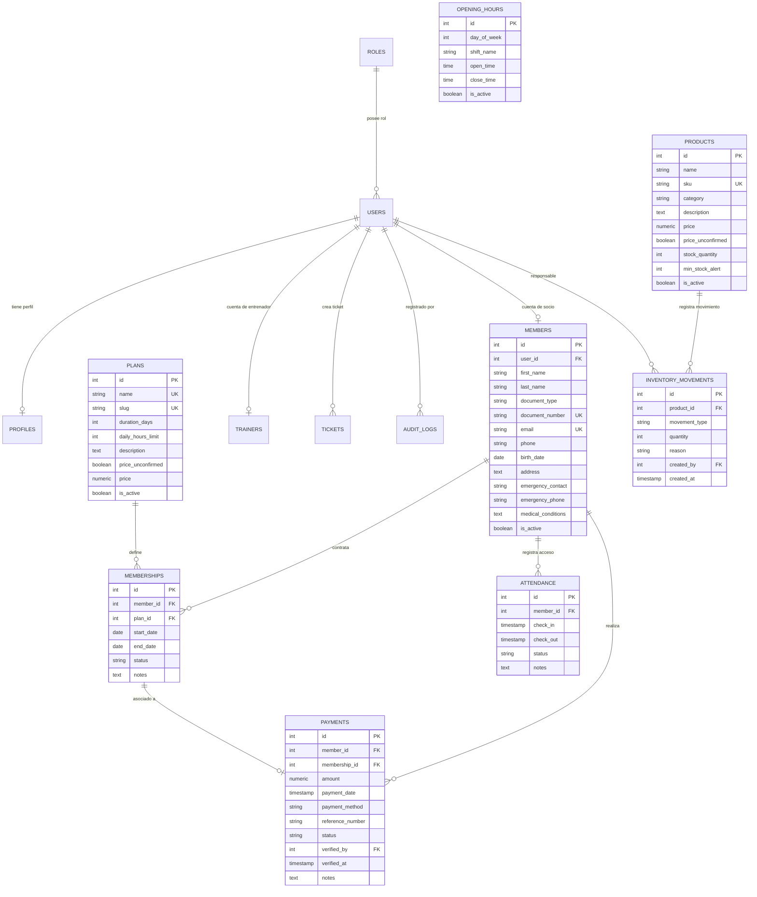

# Arquitectura del Esquema de Base de Datos — ZONA FITNESS

Este documento especifica el diseño relacional implementado en **PostgreSQL 18** para el sistema de gestión del gimnasio **ZONA FITNESS**.

---

## 1. Diagrama Entidad-Relación (ER)

---

## 2. Descripción de Entidades y Restricciones

### 2.1 Usuarios, Roles y Seguridad
- **`roles`**: Catálogo que define los roles de usuario: `admin`, `agent`, `trainer`, `member`, `user`.
- **`users`**: Cuentas de acceso al sistema. La columna `password_hash` almacena el hash criptográfico generado con `bcrypt` (factor de costo 10). **Nunca se almacenan contraseñas en texto claro**.
- **`profiles`**: Datos complementarios de contacto de emergencia, notas médicas y avatar.

### 2.2 Gestión Comercial y Clientes
- **`members`**: Registro maestro de socios. Exige unicidad en `document_number` y `email`. Clasifica el documento según valores permitidos (`CC`, `TI`, `CE`, `PASAPORTE`).
- **`plans`**: Catálogo de planes comerciales (`Cobre`, `Bronce`, `Platino`, `Oro`). Incorpora la bandera `price_unconfirmed` para mantener la integridad de los datos hasta que el gimnasio confirme formalmente las tarifas oficiales.
- **`memberships`**: Contratos de membresía. Relaciona un socio con un plan, calculando la fecha de vencimiento (`end_date`) y asegurando mediante `CHECK (end_date >= start_date)` la coherencia temporal.
- **`payments`**: Registro de pagos. Admite medios autorizados (`nequi`, `bancolombia`, `efectivo`, `tarjeta`, `transferencia`). Por seguridad y cumplimiento PCI-DSS, **no se almacenan números completos de tarjeta ni códigos CVV**. Cada pago requiere verificación administrativa explícita antes de considerarse confirmado.

### 2.3 Operaciones Diarias
- **`attendance`**: Control de acceso a las instalaciones. Valida automáticamente si el socio dispone de una membresía activa antes de otorgar el ingreso (`status: 'granted'` o `'denied'`).
- **`opening_hours`**: Horarios oficiales de atención organizados por día de la semana (1 = Lunes a 7 = Domingo) y franja horaria (mañana de 05:00 a 11:00, tarde de 15:00 a 22:00).
- **`trainers`**: Catálogo de entrenadores con especialidades y perfiles de presentación.
- **`products`**: Catálogo informativo y de venta de suplementos, batidos y artículos deportivos. Mantiene alertas de stock mínimo (`min_stock_alert`).
- **`inventory_movements`**: Bitácora de entradas, salidas y ajustes de stock con actualización en transacción atómica.

### 2.4 Soporte y Auditoría
- **`tickets`**: Sistema de soporte para incidentes, integrado con las vistas existentes de Angular (`/tickets`).
- **`audit_logs`**: Registro histórico inmutable de operaciones sensibles (`INSERT`, `UPDATE`, `DELETE`, `LOGIN`), registrando fecha, usuario responsable, dirección IP y estado previo y posterior en formato JSONB.
- **`_migrations`**: Registro de versiones y trazabilidad de ejecuciones de esquemas SQL.

---

## 3. Políticas de Seguridad Implementadas

1. **Principio de Mínimo Privilegio:** Se prevé el usuario de aplicación `zona_fitness_user` con permisos limitados exclusivamente a `SELECT`, `INSERT`, `UPDATE`, `DELETE` y `USAGE` en secuencias de `zona_fitness_db`. No se utiliza el superusuario `postgres` en la operativa cotidiana.
2. **Protección Criptográfica:** Hashing con salt mediante `bcrypt` y emisión de tokens JWT firmados con expiración limitada.
3. **Parametrización Estricta:** Todas las consultas SQL utilizan marcadores de posición (`$1`, `$2`), eliminando el riesgo de inyección SQL (SQL Injection).
4. **Validación de Entorno:** Las credenciales y claves secretas se gestionan mediante variables de entorno en `.env`, excluido del control de versiones mediante `.gitignore`.
