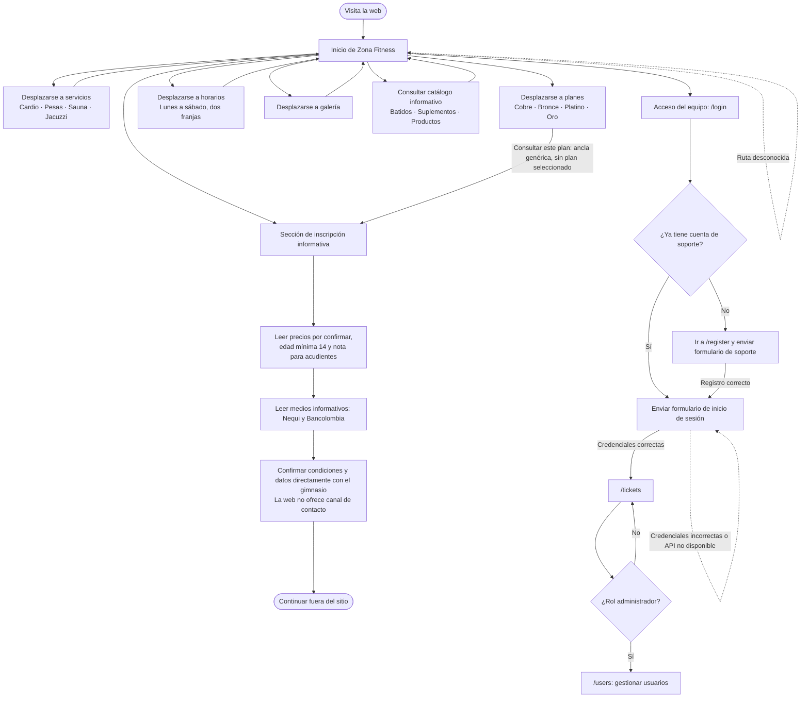

# Diagrama del flujo actual de Zona Fitness

Este diagrama describe lo que la aplicación implementa hoy. El recorrido público es informativo: no recoge datos de inscripción, no valida la edad, no selecciona un plan y no procesa pagos. Los botones de los planes solo llevan a la sección informativa de inscripción.

**Importante:** el registro y el inicio de sesión son del sistema de soporte existente, no una inscripción o cuenta de socio del gimnasio. El sitio muestra las condiciones de edad, pero no pregunta ni comprueba la edad. La confirmación de compra/inscripción y el contacto requieren información y procesos que aún no están configurados.
