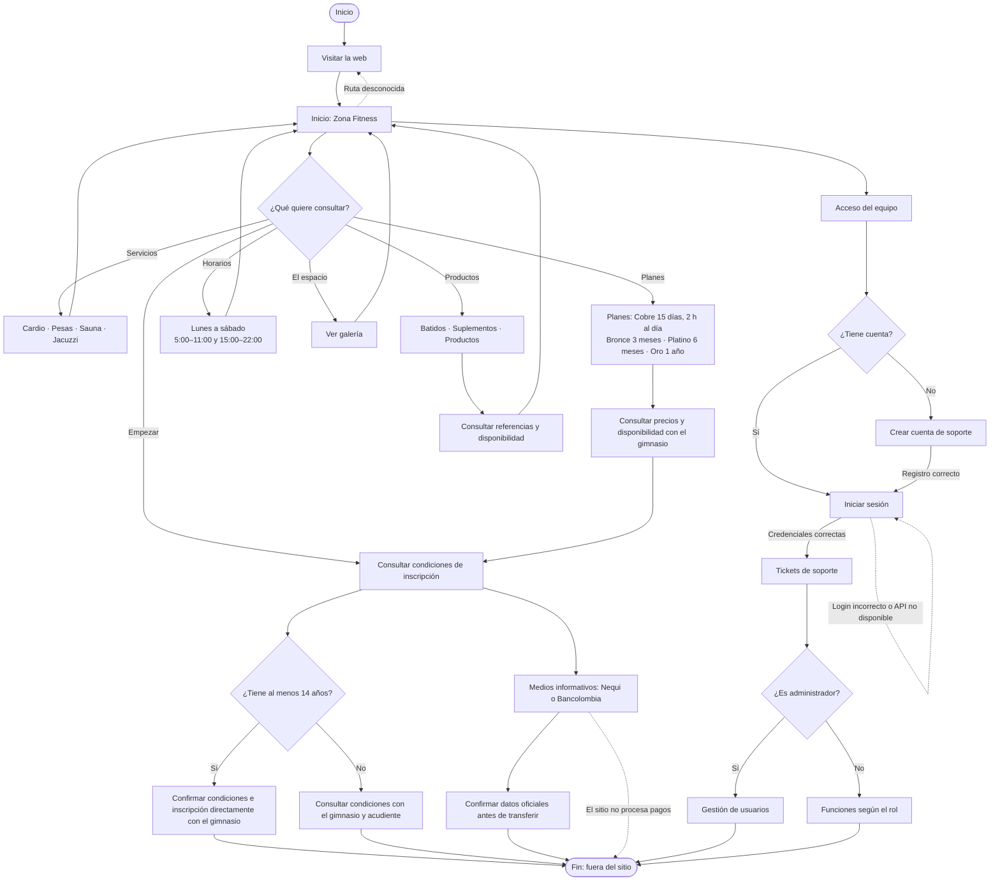

# Diagrama de flujo de Zona Fitness

El recorrido público es informativo: el sitio no gestiona inscripciones ni procesa pagos. Los precios, datos de contacto y datos de transferencia deben confirmarse directamente con el gimnasio.

> El registro y el inicio de sesión existentes son para el sistema interno de soporte; no crean una membresía del gimnasio.
