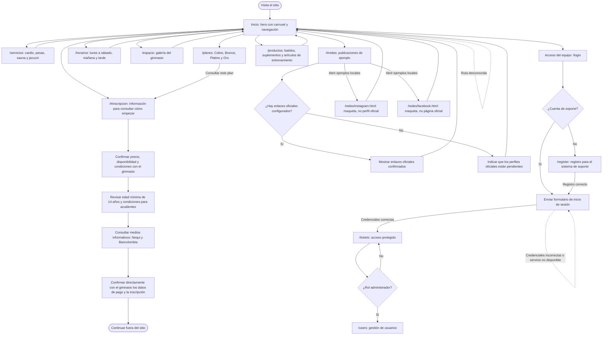

# Diagrama del flujo actual de Zona Fitness

El sitio público es promocional e informativo: presenta los servicios, planes, horarios, espacios,
productos y ejemplos visuales para redes sociales. No registra socios, no valida la edad, no
selecciona planes ni procesa pagos. Los precios y las condiciones se deben confirmar directamente
con el gimnasio.

**Importante:** el acceso y registro del equipo pertenecen al sistema de soporte, no son cuentas ni
inscripciones de socios. Los ejemplos de Instagram y Facebook son maquetas locales; no enlazan
perfiles oficiales hasta que el gimnasio confirme sus URL. La web solo informa sobre edad y medios
de pago: no valida la edad, no inicia una compra ni confirma una inscripción. El contacto y los
datos de pago oficiales siguen pendientes de confirmación.
