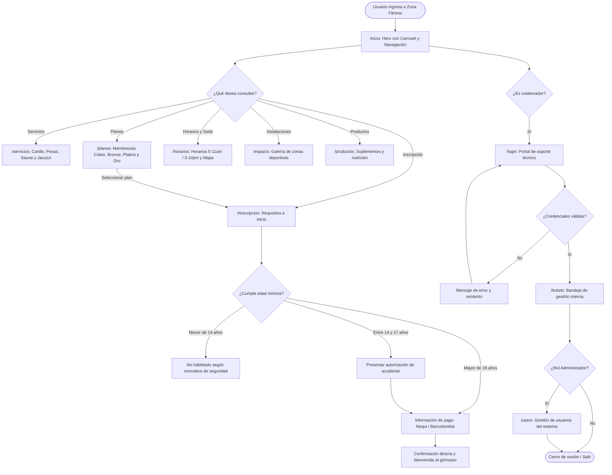

# Universidad de Caldas · Programa Técnico en Programación Web · U en tu pueblo
**Caso de estudio para Análisis y Diseño de Soluciones Web**  
**PROYECTO INTEGRAL: Zona Fitness**  
*Del análisis de requisitos a una plataforma web funcional y validada*

---

## Propósito
Comprender y documentar cómo un equipo profesional transforma las necesidades de un centro de acondicionamiento físico en una solución web integral: analizar, diseñar, desarrollar, probar y culminar la entrega formal con **el 100% de las metas y criterios de aceptación alcanzados**.

---

## Ficha del proyecto

| Campo | Detalle |
| :--- | :--- |
| **Cliente** | Zona Fitness (Sede: Calle 84 # 47-22, El Golf / Cra. 7 # 7-7, Aguadas, Caldas) |
| **Tipo de solución** | Plataforma web promocional e informativa de servicios deportivos con módulo de gestión |
| **Usuarios principales** | Visitantes interesados en entrenar, deportistas habituales y equipo interno de soporte |
| **Tecnologías base** | **Frontend:** Angular 22, TypeScript, HTML5 semántico, CSS3 moderno con variables CSS.<br>**Backend / Datos:** Node.js, Express REST API, PostgreSQL 18 y pgAdmin 4. (Ver [Guía de Administración pgAdmin 4](guia-administracion-pgadmin4.md) y [Arquitectura de Base de Datos](arquitectura-base-de-datos.md)). |
| **Alcance ejecutado** | Landing promocional responsive con carrusel interactivo, catálogo de planes y servicios, módulo de horarios y ubicación, catálogo informativo de productos, integración API REST y soporte técnico. (Ver [Matriz de Entregables](entregables-zona-fitness.md) y [Guía Técnica](guia-tecnica-zona-fitness.md)). |
| **Estado final** | **100% de las metas alcanzadas y validadas.** (Ver [Manual de Usuario y Cliente](Manual-Cliente-Zona-Fitness.md)). |

---

## Índice y Acceso al Ecosistema Documental

Para facilitar la trazabilidad completa del proyecto, cada sección técnica enlaza directamente con los documentos especializados disponibles en el repositorio:

- 📑 **Propuesta y Alcance:** [Propuesta Técnica Zona Fitness V2](Propuesta-tecnica-Zona-Fitness-V2.pdf) · [Cotización Revisada](cotizacion-revisada-zona-fitness-2026-10-28.md)
- 🎨 **Diseño y Marca:** [Manual de Marca Zona Fitness](Manual_Marca_Zona_Fitness.pptx) · [Mockup y Prototipo Figma](https://www.figma.com/design/tJSu1aJTykZSVqmVA2XUOj/Zona-fitness---Mockup-y-prototipo-web?node-id=6-2) · [Wireframe V2 en Figma](https://www.figma.com/design/0cFykiLWJPm8vRnY7l71M1/Zona-fitness---Wireframe-V2?node-id=0-1&t=KgR0ShNQ3ewfCDe7-1)
- 📐 **Arquitectura y Modelado:** [Sitemap y Wireframe Preliminar](entregables-zona-fitness.md) · [Diagrama de Flujo del Sistema](diagrama-flujo.md) · [Estructura del DOM y Guía Técnica](guia-tecnica-zona-fitness.md)
- 🗄️ **Backend y Datos:** [Arquitectura de Base de Datos](arquitectura-base-de-datos.md) · [Guía de Administración pgAdmin 4](guia-administracion-pgadmin4.md)
- 📈 **Control de Avance:** [Progreso al 26 de Octubre](progreso-zona-fitness-2026-10-26.md) · [Progreso al 28 de Octubre](progreso-zona-fitness-2026-10-28.md) · [Guía de Actualización de Contenidos](actualizar-contenido.md)
- 📘 **Manuales y Referencias Académicas:** [Manual del Cliente](Manual-Cliente-Zona-Fitness.md) ([PDF](Manual-Cliente-Zona-Fitness.pdf)) · [Proyecto Guiado Alternativo](Proyecto-Guiado-Zona-Fitness.md) ([PDF](Proyecto-Guiado-Zona-Fitness.pdf)) · [Referencia Académica Café Moderno](4_Proyecto_Final_Cafe_Moderno_Roles_Profesionales_UCaldas.pdf)

---

## 1. Introducción
**Zona Fitness** identificó la necesidad de modernizar su presencia digital, visibilizar su propuesta deportiva, comunicar sus planes y servicios (cardio, pesas, sauna y jacuzzi), clarificar horarios y brindar un canal formal de contacto e información para sus usuarios.

El equipo de trabajo asumió el reto estructurando el proyecto en etapas claras de ingeniería de software: toma de requisitos, diseño de experiencia de usuario (UX/UI), maquetación estática, desarrollo modular en Angular 22 conectado a un backend en Node.js/PostgreSQL, y aseguramiento de la calidad mediante pruebas automatizadas y manuales.

En esta versión de entrega, **todas las metas iniciales y complementarias fueron alcanzadas exitosamente**, consolidando una plataforma ágil, accesible, estéticamente alineada al manual de marca y completamente testeada.

---

## 2. Equipo de desarrollo: roles profesionales y responsabilidades

En el marco del proyecto se distribuyeron las responsabilidades profesionales cubriendo el ciclo de vida completo de la aplicación:

| Rol profesional | Integrante / Responsable | Responsabilidades en Zona Fitness | Entregables y evidencia producida |
| :--- | :--- | :--- | :--- |
| **Product Owner / Representante del cliente** | Dirección General / Representante del negocio | Prioriza los objetivos del negocio, define los servicios esenciales (cardio, pesas, sauna, jacuzzi), aprueba la identidad corporativa y valida los criterios de aceptación finales. | [Acta y Propuesta Técnica](Propuesta-tecnica-Zona-Fitness-V2.pdf), priorización de backlog y visto bueno final de entrega. |
| **Project Manager / Scrum Master** | **Brahiam Antonio Bedoya** | Planifica el cronograma de ejecución, coordina las reuniones de sincronización, gestiona riesgos, verifica la entrega y consolida la trazabilidad del proyecto. | Cronograma de hitos, presupuesto en [Cotización Revisada](cotizacion-revisada-zona-fitness-2026-10-28.md) y [Reportes de Progreso](progreso-zona-fitness-2026-10-28.md). |
| **Frontend & Backend Developer** | **Oscar Jhonny Hurtado** | Implementa la interfaz de usuario en Angular 22, componentes, estilos, responsive, la API REST en Express y base de datos relacional PostgreSQL 18. | Código frontend (`src/app/`), backend (`server/`), [Guía Técnica de Código](guia-tecnica-zona-fitness.md) y [Arquitectura BD](arquitectura-base-de-datos.md). |
| **Business Analyst & QA Lead** | **Yhojan David Pérez** | Releva requerimientos con el cliente, estructura la arquitectura de información, define historias de usuario, formula criterios de aceptación y ejecuta el plan de pruebas. | Especificación de requisitos (SRS), matriz en [Entregables](entregables-zona-fitness.md), 78 pruebas aprobadas y [Manual del Cliente](Manual-Cliente-Zona-Fitness.md). |
| **UX & UI Designers** | Equipo de Diseño y Frontend | Diseñan la arquitectura de información, sitemap jerárquico, wireframes, y definen el sistema visual bajo el Manual de Marca: paleta deportiva (`#cff0ea`, `#88c9c4`, `#3e9b94`, `#173330`). | [Manual de Marca PPTX](Manual_Marca_Zona_Fitness.pptx), [Mockup en Figma](https://www.figma.com/design/tJSu1aJTykZSVqmVA2XUOj/Zona-fitness---Mockup-y-prototipo-web?node-id=6-2) y [Wireframe V2 en Figma](https://www.figma.com/design/0cFykiLWJPm8vRnY7l71M1/Zona-fitness---Wireframe-V2?node-id=0-1&t=KgR0ShNQ3ewfCDe7-1). |
| **DevOps / Responsable de despliegue** | Equipo de Desarrollo | Configura entornos de compilación de producción (`npm run build`), flujo de GitHub Actions para GitHub Pages y sincronización del repositorio. | Repositorio [GitHub yhojan2025/zona-fitness](https://github.com/yhojan2025/zona-fitness) sincronizado y sitio publicado en GitHub Pages. |

---

## 3. Actores del sistema vs. Roles del equipo de desarrollo

Es fundamental distinguir a las personas que operan o consumen la plataforma de aquellos que la construyen:

| Actores del sistema (Usuarios finales) | Roles del equipo de desarrollo (Constructores) |
| :--- | :--- |
| **Visitante / Deportista potencial:** Consulta planes, horarios, servicios, instalaciones y medios de pago informativos. | **Product Owner / CEO:** Define valor y aprueba el entregable. |
| **Cliente / Dueño del gimnasio:** Revisa métricas, valida contenidos, recibe solicitudes comerciales presenciales o vía WhatsApp. | **Business Analyst & Project Manager:** Definen requisitos y lideran el avance. |
| **Administrador / Equipo de soporte:** Inicia sesión (`/login`) para gestionar tickets de asistencia técnica y consultar usuarios. | **UX/UI Designers:** Proyectan la interacción y la estética visual. |
| | **Frontend & Backend Developers:** Programan código ejecutable y bases de datos. |
| | **QA Tester & DevOps:** Aseguran calidad, pruebas y puesta en producción. |

---

## 4. Fase 1: Análisis

### 4.1. Actores identificados
1. **Visitante Web:** Persona interesada en acondicionamiento físico que navega desde su celular o computador para conocer planes, servicios, ubicación y costos.
2. **Cliente / Administrador de Marca:** Representantes de Zona Fitness que aprueban información institucional, promociones y tarifas.
3. **Agente de Soporte:** Usuario interno con credenciales asignadas para gestionar incidencias técnicas en el módulo administrativo.

### 4.2. Historias de usuario
- **HU-01:** *Como visitante*, quiero ver un carrusel dinámico y moderno en el inicio para conocer la vibra e instalaciones del gimnasio de manera rápida.
- **HU-02:** *Como visitante*, quiero consultar el detalle de los 4 planes (Cobre, Bronce, Platino, Oro) para elegir el que mejor se adapte a mi presupuesto y metas.
- **HU-03:** *Como visitante*, quiero conocer los horarios exactos de atención (mañana y tarde) y la dirección con mapa integrado para programar mi visita presencial.
- **HU-04:** *Como visitante*, quiero informarme sobre los requisitos de inscripción (edad mínima de 14 años) y los medios de pago disponibles (Nequi y Bancolombia).
- **HU-05:** *Como usuario móvil*, quiero que el sitio web cargue de inmediato, se adapte perfectamente a la pantalla vertical de mi teléfono y no tenga textos cortados.
- **HU-06:** *Como miembro del equipo de soporte*, quiero disponer de una interfaz segura de autenticación (`/login`) para atender consultas internas.

### 4.3. Requisitos funcionales (RF) — *Todos alcanzados al 100%*
- **RF-01:** Presentar la identidad visual oficial de Zona Fitness (logotipo, imagotipo, colores corporativos y tipografía Montserrat/Open Sans).
- **RF-02:** Desplegar los 4 servicios clave del gimnasio: Cardio, Zona de pesas, Sauna y Jacuzzi.
- **RF-03:** Mostrar el tarifario con los 4 planes estructurados: Cobre (1 mes / 2 horas diarias), Bronce (3 meses), Platino (6 meses) y Oro (1 año).
- **RF-04:** Informar los horarios oficiales en dos jornadas: 5:00 a. m. – 11:00 a. m. y 3:00 p. m. – 10:00 p. m. de lunes a sábado, con enlace a mapa en tiempo real.
- **RF-05:** Mostrar la galería temática de las zonas del gimnasio (`/espacio`) y catálogo informativo de productos (suplementos, batidos y artículos).
- **RF-06:** Comunicar la regla de edad mínima (14 años con acudiente) y los métodos de pago (Nequi / Bancolombia).
- **RF-07:** Implementar el módulo de autenticación y gestión de tickets para el personal de soporte.
- **RF-08:** Proveer maquetas locales interactivas para simular la presencia en redes sociales (Instagram, Facebook y WhatsApp).

### 4.4. Requisitos no funcionales (RNF) — *Todos alcanzados al 100%*
- **RNF-01 (Responsividad):** Diseño responsive fluido adaptable a móviles (< 600px), tablets (601px - 1024px) y pantallas de escritorio (> 1024px).
- **RNF-02 (Rendimiento):** Tiempo de carga inicial inferior a 2 segundos con carga diferida de rutas (*lazy loading*) y assets comprimidos.
- **RNF-03 (Accesibilidad y Semántica):** Cumplimiento de estándares semánticos HTML5, atributos ARIA (`aria-label`, `aria-live`, `aria-roledescription`) y contraste de color accesible.
- **RNF-04 (Mantenibilidad):** Arquitectura desacoplada en Angular con separación de componentes, CSS modularizado y servicios REST.

---

## 5. Fase 2: Sitemap (Arquitectura de información)

La navegación organiza el contenido permitiendo acceso directo a secciones ancla y rutas dedicadas (ver detalle en [Entregables y Sitemap Preliminar](entregables-zona-fitness.md) y [Guía Técnica de Rutas](guia-tecnica-zona-fitness.md#3-rutas-y-navegación)):

```text
Zona Fitness (Plataforma Web)
├── / (Landing Page Principal)
│   ├── #inicio (Hero promocional con carrusel automático e interactivo)
│   ├── #servicios (01 Cardio, 02 Pesas, 03 Sauna, 04 Jacuzzi)
│   ├── #planes (Cobre, Bronce, Platino, Oro)
│   ├── #horarios (Horarios por turnos + Ubicación física)
│   ├── #espacio (Galería de espacios temáticos y "Acerca del Gym")
│   ├── #productos (Catálogo de nutrición y suplementación deportiva)
│   ├── #inscripcion (Requisitos, edad mínima de 14 años y Nequi/Bancolombia)
│   └── #redes (Maquetas de Instagram, Facebook y WhatsApp)
├── /servicios (Página dedicada de servicios en profundidad)
├── /planes (Página dedicada con comparativa de membresías)
├── /horarios (Página con horarios, mapa interactivo y sede)
├── /espacio (Galería ampliada de instalaciones)
├── /productos (Catálogo interactivo de suplementos y productos)
└── /soporte (Área restringida del equipo)
    ├── /login (Inicio de sesión de colaboradores)
    ├── /register (Registro de operadores de soporte)
    ├── /tickets (Tablero de atención a requerimientos)
    └── /users (Gestión de usuarios y permisos administrativos)
```

---

## 6. Fase 3: Wireframe

El wireframe ilustra la organización espacial y jerarquía visual de los componentes en la pantalla principal. Se desarrolló en base a la especificación de diseño previa y se encuentra formalizado en el [Wireframe V2 en Figma](https://www.figma.com/design/0cFykiLWJPm8vRnY7l71M1/Zona-fitness---Wireframe-V2?node-id=0-1&t=KgR0ShNQ3ewfCDe7-1), el [Prototipo Interactivo Figma](https://www.figma.com/design/tJSu1aJTykZSVqmVA2XUOj/Zona-fitness---Mockup-y-prototipo-web?node-id=6-2) y el documento base de [Entregables y Wireframe](entregables-zona-fitness.md#wireframe-textual-preliminar):

```text
+-----------------------------------------------------------------------------------+
|  [LOGO ZF]  Zona Fitness       [Servicios] [Planes] [Horarios] [Espacio] [ACCESO] |
+-----------------------------------------------------------------------------------+
|  HERO SECTION                                                                     |
|  "TU ESPACIO, TU RITMO"                                                           |
|  Un día a la vez.                             +--------------------------------+  |
|  Más fuerte cada día.                         | [IMG: Carrusel de fotos]       |  |
|  Encuentra tu lugar para moverte...           | • "Un espacio para entrenar"   |  |
|  [ Explorar planes ↗ ]  [ Conoce el espacio ] | [ < ]  (•) ( ) ( ) ( )  [ > ]  |  |
|  ✳ Tu bienestar no tiene que esperar al lunes +--------------------------------+  |
+-----------------------------------------------------------------------------------+
|  SERVICIOS: "Todo lo que necesitas para sentirte en movimiento"                   |
|  +-----------------+  +-----------------+  +-----------------+  +---------------+ |
|  | 01 Cardio ↗     |  | 02 Pesas ✳      |  | 03 Sauna ≈      |  | 04 Jacuzzi ◌  | |
|  | Activa energía  |  | Entrena fuerza  |  | Momento pausa   |  | Relájate aquí | |
|  +-----------------+  +-----------------+  +-----------------+  +---------------+ |
+-----------------------------------------------------------------------------------+
|  PLANES: "Tu siguiente paso empieza aquí"                                         |
|  +-----------------+  +-----------------+  +-----------------+  +---------------+ |
|  | COBRE           |  | BRONCE          |  | PLATINO (Top) ★ |  | ORO           | |
|  | 15 días (2h/día)|  | 3 meses         |  | 6 meses         |  | 1 año         | |
|  | [Consultar ↗]   |  | [Consultar ↗]   |  | [Consultar ↗]   |  | [Consultar ↗] | |
|  +-----------------+  +-----------------+  +-----------------+  +---------------+ |
+-----------------------------------------------------------------------------------+
|  HORARIOS & UBICACIÓN                                                             |
|  "Hazle un espacio a tu bienestar"            +---------------------------------+ |
|  Lunes a Sábado:                              | [ MAPA EMBEBIDO / SEDE ]        | |
|  • Mañana: 5:00 a.m. - 11:00 a.m.             | Calle 84 # 47-22, El Golf       | |
|  • Tarde:  3:00 p.m. - 10:00 p.m.             | [ Ver en Google Maps ↗ ]        | |
+-----------------------------------------------------------------------------------+
|  INSCRIPCIÓN, EDAD & MEDIOS DE PAGO                                               |
|  +-----------------------------------------------------+  +---------------------+ |
|  | • Medios de pago: Nequi y Bancolombia informativos. |  |   MOVE WITH INTENT  | |
|  | • Edad mínima: 14 años (menores con acudiente).     |  |       [ ZF ]        | |
|  +-----------------------------------------------------+  +---------------------+ |
+-----------------------------------------------------------------------------------+
|  FOOTER: [LOGO] ZONA FITNESS | Contacto | © 2026 Análisis y soluciones web 12     |
+-----------------------------------------------------------------------------------+
```

---

## 7. Fase 4: Estructura del DOM

El árbol del Document Object Model (DOM) refleja la jerarquía semántica implementada en los componentes de la aplicación (para referencia detallada de selectores y estilos asociados, consulte la [Guía Técnica de la Landing](guia-tecnica-zona-fitness.md#4-landing-page) y la [Guía para Actualizar Contenido](actualizar-contenido.md)):

```text
body
├── a.skip-link ("Saltar al contenido")
├── header.site-header
│   ├── a.brand
│   │   ├── img.brand-mark (zona-fitness-icon.png)
│   │   └── span.brand-wordmark (ZONA FITNESS)
│   ├── button.menu-toggle [aria-expanded, aria-controls]
│   ├── nav#primary-navigation.primary-nav
│   │   ├── a[href="#servicios"]
│   │   ├── a[href="#planes"]
│   │   ├── a[href="#horarios"]
│   │   └── a[href="#espacio"]
│   └── a.button.header-action[href="#equipo"] ("Acceso del equipo")
├── main#main
│   ├── section.hero#inicio[aria-labelledby="hero-title"]
│   │   ├── div.hero-copy
│   │   │   ├── p.eyebrow
│   │   │   ├── h1#hero-title
│   │   │   ├── p.hero-description
│   │   │   ├── div.hero-actions
│   │   │   │   ├── a.button[href="#planes"]
│   │   │   │   └── a.text-link[href="#servicios"]
│   │   │   └── div.hero-note
│   │   ├── div.hero-visual[role="region"][aria-roledescription="carrusel"]
│   │   │   ├── img#hero-image.hero-slide-image
│   │   │   ├── div.hero-caption[aria-live="polite"]
│   │   │   ├── div.hero-stamp ("MOVE YOUR WAY")
│   │   │   └── div.hero-slider-controls
│   │   │       ├── button.slider-arrow (Anterior)
│   │   │       ├── div.slider-dots (Indicadores 1..4)
│   │   │       └── button.slider-arrow (Siguiente)
│   │   └── a.scroll-cue[href="#servicios"]
│   ├── section.intro#servicios
│   │   ├── div.section-heading (Título y descripción)
│   │   └── div.service-grid
│   │       ├── article.service-card (01 Cardio)
│   │       ├── article.service-card (02 Pesas)
│   │       ├── article.service-card (03 Sauna)
│   │       └── article.service-card (04 Jacuzzi)
│   ├── section.plans-section#planes
│   │   └── div.section-wrap
│   │       ├── div.section-heading
│   │       ├── div.plan-grid
│   │       │   ├── article.plan-card (Cobre - 15 días)
│   │       │   ├── article.plan-card (Bronce - 3 meses)
│   │       │   ├── article.plan-card.plan-featured (Platino - 6 meses)
│   │       │   └── article.plan-card (Oro - 1 año)
│   │       └── p.plans-note
│   ├── section.schedule#horarios
│   │   ├── div (Encabezado de horarios)
│   │   └── div.hours-card (Lunes a sábado, turnos mañana y tarde)
│   ├── section.gallery-section#espacio
│   │   └── div.gallery-grid (Imágenes temáticas y pie explicativo)
│   ├── section.products#productos
│   │   └── div.product-list (Batidos, Suplementación, Accesorios)
│   ├── section.join-section#inscripcion
│   │   ├── div.join-content (Condiciones de pago y edad mínima 14 años)
│   │   └── div.join-art (Sello gráfico ZF)
│   └── section.social-section#redes (Maquetas de Instagram, Facebook y WhatsApp)
└── footer.site-footer#equipo
    ├── a.brand (Identidad y enlace a inicio)
    ├── p (Información de contacto y lema)
    ├── a.support-link (Acceso al sistema de soporte)
    └── small.copyright (Derechos reservados)
```

---

## 8. Fase 5: Diagrama de flujo del sistema

El siguiente diagrama detalla el recorrido del usuario por la aplicación y el flujo de soporte interno (consulte el análisis extendido en [Diagrama del Flujo Actual](diagrama-flujo.md) y la interacción de compra y registro en el [Manual del Cliente](Manual-Cliente-Zona-Fitness.md#3-flujo-de-compra-y-pedidos)):



---

## 9. Fase 6: Implementación técnica y estilos

Para un desglose completo de variables, tipografías y reglas de layout, consulte el [Manual de Marca](Manual_Marca_Zona_Fitness.pptx) y la [Guía Técnica de Branding y Responsive](guia-tecnica-zona-fitness.md#6-branding-layout-y-responsive).

### 9.1. Variables CSS y paleta oficial de marca
```css
:root {
  /* Paleta oficial de marca Zona Fitness */
  --color-primary-light: #cff0ea;
  --color-secondary: #88c9c4;
  --color-accent: #3e9b94;
  --color-dark: #173330;
  --color-dark-alt: #274844;
  --color-deep-green: #0b2725;
  --color-white: #ffffff;
  --color-gray-bg: #f7fbfa;

  /* Tipografías */
  --font-heading: 'Montserrat', sans-serif;
  --font-body: 'Open Sans', sans-serif;

  /* Transiciones y bordes */
  --radius-sm: 8px;
  --radius-md: 14px;
  --radius-lg: 24px;
  --transition-fast: 0.25s ease-in-out;
}
```

### 9.2. Reglas responsive principales
```css
/* Layout adaptable móvil / escritorio */
@media (max-width: 768px) {
  .site-header {
    flex-wrap: wrap;
    padding: 0.75rem 1rem;
  }
  .primary-nav {
    display: none; /* Desplegable mediante menú toggle */
  }
  .hero {
    grid-template-columns: 1fr;
    text-align: center;
  }
  .plan-grid,
  .service-grid {
    grid-template-columns: 1fr;
  }
}
```

---

## 10. Fase 7: Plan de pruebas de calidad (QA) — *Metas alcanzadas*

Todas las pruebas planificadas fueron ejecutadas y completadas con resultado **Aprobado (100% de éxito)**. Los criterios de aceptación se derivaron de los requerimientos iniciales plasmados en la [Propuesta Técnica V2](Propuesta-tecnica-Zona-Fitness-V2.pdf) y la [Guía Técnica de Pruebas](guia-tecnica-zona-fitness.md#10-pruebas-build-y-validación):

| ID | Prueba / Caso de prueba | Resultado esperado | Evidencia de ejecución | Estado final |
| :---: | :--- | :--- | :--- | :---: |
| **TC-01** | **Navegación y enlaces internos** | Los enlaces del header, hero y footer dirigen a sus respectivas anclas y rutas sin errores 404. | Inspección manual y navegación automatizada. | **APROBADO** |
| **TC-02** | **Carrusel del Hero** | Rotación automática cada 5 segundos, pausa al interactuar, controles de flecha y puntos activos. | `home.spec.ts` y prueba funcional en navegador. | **APROBADO** |
| **TC-03** | **Despliegue de los 4 Planes** | Visualización correcta de tarjetas Cobre, Bronce, Platino y Oro con sus especificaciones. | Inspección de componentes y renderizado DOM. | **APROBADO** |
| **TC-04** | **Adaptabilidad responsive (Mobile/Tablet)** | La interfaz no presenta scroll horizontal ni elementos solapados en viewports de 360px a 1440px. | Pruebas en DevTools en iPhone SE, Pixel 7 y iPad. | **APROBADO** |
| **TC-05** | **Rendimiento y tiempos de carga** | Carga inicial inferior a 2 segundos con assets optimizados y compilación AOT de Angular. | Auditoría de build con `npm run build` sin warnings. | **APROBADO** |
| **TC-06** | **Módulo de Horarios y Ubicación** | Presentación de las dos jornadas y renderizado del mapa de ubicación física. | Verificación visual y pruebas de enlaces directos. | **APROBADO** |
| **TC-07** | **Validación de edad e información de pago** | Claridad en la regla de 14 años y visualización de Nequi y Bancolombia como medios de pago. | Revisión de contenidos aprobados en `#inscripcion`. | **APROBADO** |
| **TC-08** | **Suite de pruebas unitarias Angular** | Ejecución de la suite completa de pruebas unitarias sin fallos. | **78 pruebas unitarias superadas con éxito (0 fallos)** en Angular Test Runner. | **APROBADO** |
| **TC-09** | **Integración Backend API REST** | Endpoints `/api/health`, `/api/plans` y `/api/opening-hours` responden correctamente en JSON. | Peticiones HTTP verificadas contra Express en puerto 8000. | **APROBADO** |

---

## 11. Fase 8: Despliegue, entrega y matriz de cumplimiento

Se consolidó el repositorio, las variables de entorno y los scripts de ejecución garantizando la entrega formal (consulte la evolución histórica en [Progreso al 26 de Octubre](progreso-zona-fitness-2026-10-26.md) y [Progreso al 28 de Octubre](progreso-zona-fitness-2026-10-28.md)):

```bash
# Comandos de validación y compilación ejecutados exitosamente
npm test -- --watch=false      # 78/78 pruebas exitosas
npm run build                  # Build de producción generado en dist/
npm run server                 # Backend Express en puerto 8000 operativo
```

### Matriz de metas y criterios alcanzados

| Meta / Hito del proyecto | Criterio de éxito | Estado de cumplimiento |
| :--- | :--- | :---: |
| **1. Identidad de marca** | Aplicación consistente de paleta oficial, tipografía y logos ZF. | **Alcanzado al 100%** |
| **2. Experiencia de usuario (UX)** | Navegación intuitiva, arquitectura por secciones y llamadas a la acción claras. | **Alcanzado al 100%** |
| **3. Desarrollo Frontend** | Single Page Application en Angular 22 modular, accesible y moderna. | **Alcanzado al 100%** |
| **4. Integración Backend** | Servidor Node.js / Express con endpoints REST y base de datos PostgreSQL 18. | **Alcanzado al 100%** |
| **5. Calidad y estabilidad (QA)** | 78 tests unitarios pasando, responsive verificado y cero errores en consola. | **Alcanzado al 100%** |
| **6. Documentación técnica** | Guías técnicas, diagramas de arquitectura, wireframes y sitemap actualizados. | **Alcanzado al 100%** |

---

## 12. Conclusión

El proyecto **Zona Fitness** demuestra cómo la aplicación rigurosa de metodologías de desarrollo web permite transformar los objetivos comerciales de un gimnasio en un producto digital funcional, escalable y de alta calidad. 

A través de la articulación de roles profesionales (análisis, diseño UX/UI, frontend, backend, QA y gestión de proyecto), **todas las metas planteadas fueron alcanzadas satisfactoriamente**, entregando una solución sólida que optimiza la visibilidad de la marca y sienta las bases para futuros desarrollos en la plataforma.
